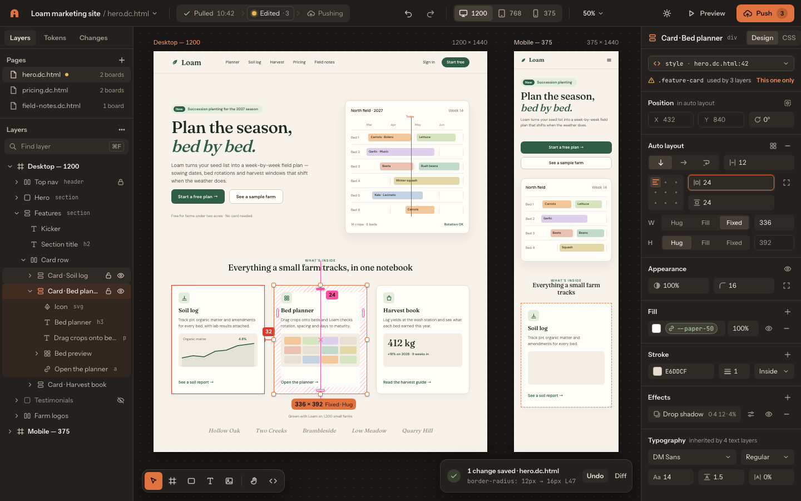
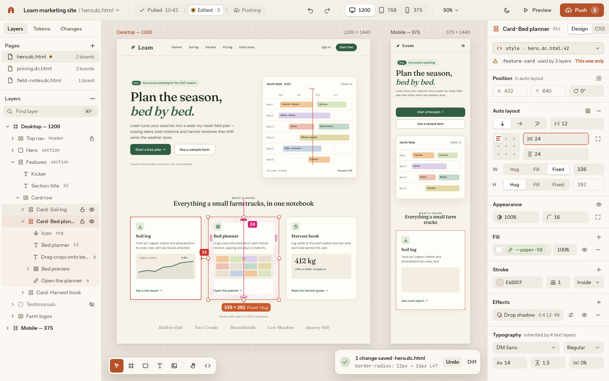
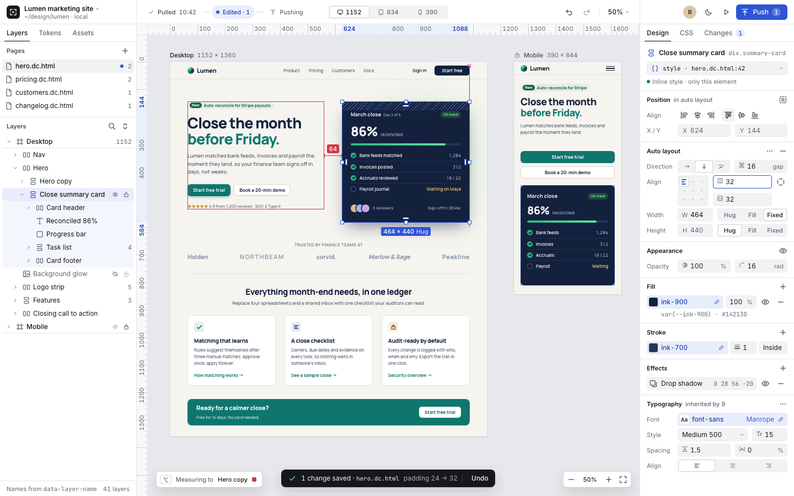
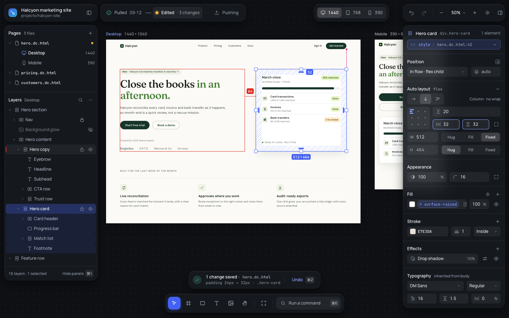

# design-editor

A local, Figma-style visual editor for **Claude Design** canvases.

Claude makes the design. You hand-tune it with the mouse: select, drag, resize, snap, measure,
Auto Layout, a real properties panel, design tokens. Every change is spliced straight into the
canvas's own HTML. There is no conversion and no separate design file, and an untouched session
leaves a zero-byte diff. When you're done, one command syncs it back to Claude Design.

```
/design-pull <canvas link>   →   edit on the canvas   →   /design-push
```

Runs on **macOS and Windows**.

> **Status: in development.** The plan is done and reviewed (`plans/v1/plan.md`). Implementation
> is in progress. The screenshots below are the chosen UI direction (a design mockup), not the
> running app yet.





## What it does

- **Canvas that feels like Figma.**
  - Click picks the top-level element, double-click goes deeper, Cmd/Ctrl-click picks the deepest element.
  - Drag a child of a flex or grid layout to reorder it; drag an absolutely positioned element to move it.
  - 8 resize handles, smart guides and snapping, Alt-hover red distance lines, zoom and pan.
- **Auto Layout is CSS flexbox.** Direction, gap, padding handles, 9-dot alignment, and Hug / Fill / Fixed
  sizing. All of it is written as real CSS.
- **Properties panel.**
  - Shows exactly which rule and line you're editing (`style · hero.dc.html:42`).
  - Warns before you touch a class shared by other elements.
  - Number inputs keep your units; the colour picker keeps the colour format you wrote.
  - The token picker reads `tokens.json`.
- **Clean write-back.** Byte-exact splices, so formatting, comments, line endings (CRLF/LF) and BOMs all
  survive. Undo uses file snapshots.
- **Safe sync.** Push does a three-way merge against what you pulled, never silently overwrites
  remote edits, and stops on any conflict.

## How it works

```
browser: editor UI (React panels + overlay)  ──ws──  Node server on 127.0.0.1
   └─ sandboxed iframe (second port) running the canvas         ├─ SourceIndex (parse5 + PostCSS offsets)
                                                                ├─ PatchEngine (magic-string splices)
                                                                ├─ Writer (atomic, retry on Windows locks)
                                                                └─ edsync CLI (pull / push / merge, git)
```

The full design, decisions and trade-offs are in [`plans/v1/plan.md`](plans/v1/plan.md). The research
behind it (Figma's interaction model, layout-to-CSS mapping, prior art like Onlook / Webflow / Penpot,
Windows pitfalls) is in [`plans/v1/research/`](plans/v1/research/), with sources.

## UI directions considered

| A — Quiet precision | B — Warm studio (chosen) | C — Floating focus |
|---|---|---|
|  |  |  |

## License

MIT
